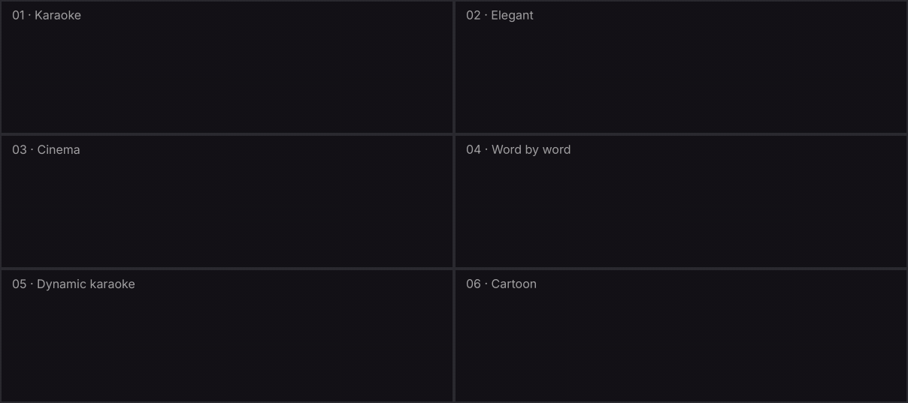

# Future Captions 🎬

**Animated captions for your videos, made by Claude.** Upload a video, review the transcript, pick a style, and download three files: the video with captions burned in, a captions-only video with a transparent background for your editor, and an SRT file.

[**⬇️ Download future-captions.zip**](https://github.com/touchstd/future-captions/releases/latest/download/future-captions.zip)



*[Leia em português ↓](#português)*

---

## What it does

1. **Transcribes** your video, detects the language and times every single word.
2. **Shows you the transcript** to review. Click Edit, fix any word, then Approve.
3. **Lets you pick a text style** (keep or hide punctuation; as spoken, lowercase or UPPERCASE) and one or two lines.
4. **Shows live previews of six animated presets:** Karaoke, Elegant, Cinema, Word by word, Dynamic karaoke and Cartoon.
5. **Renders three files**, each with its own download button, so you grab only what you need:
   - `_captioned.mp4`: the video with captions burned in, ready to post.
   - `_captions_alpha.mov`: captions only, transparent background (QuickTime Animation with alpha). Drop it on the layer above your video in After Effects, Premiere, DaVinci Resolve or Final Cut. It has the same size, frame rate and duration, so it lines up at 0:00.
   - `.srt`: a standard subtitle file for YouTube and players.

Vertical videos (9:16) are detected automatically, and the captions sit higher so they stay clear of the Instagram and TikTok buttons.

## Install (2 minutes, once)

1. **Download** [`future-captions.zip`](https://github.com/touchstd/future-captions/releases/latest/download/future-captions.zip). Don't unzip it.
2. **Turn on code execution.** In Claude, open **Settings → Capabilities** and enable **Code execution and file creation**. On Team or Enterprise plans an admin may need to enable it.
3. **Upload the skill.** Go to **Customize → Skills**, click **+**, then **Create skill → Upload a skill**, and choose the ZIP.

## Use it

Start a new chat, attach your video (MP4, MOV or WebM) and type:

```
/future-captions
```

Claude walks you through each step. Want everything in one ZIP instead? Just ask. After the render, you can ask for tweaks in plain language: bigger text, a different color, captions in the middle or at the top, another preset. Claude re-renders with the same approved transcript, so you never start over.

## Good to know

- **First run takes a minute longer.** The speech models (about 600 MB) download from GitHub once per chat. If Claude says it couldn't download them, make sure code execution has network access to `github.com`.
- **Rendering takes roughly 1–3× the video length.**
- **Big files:** chat uploads have a size limit. If a long 4K video won't upload, export a 1080p copy. That's plenty for captions.
- **Languages:** exact word timing for 25 European languages (English, Portuguese, Spanish, French, German, Italian and more). Other languages (Japanese, Chinese, Korean, Arabic…) work too, with word timing estimated per phrase. For those, the Cinema preset looks best.
- **Haloed edges in After Effects?** Right-click the footage → Interpret Footage → Main → Alpha: **Straight – Unmatted**.

## Changelog

See [CHANGELOG.md](CHANGELOG.md).

## License

Code: [MIT](LICENSE). Bundled fonts (Montserrat, Playfair Display, Inter, Bricolage Grotesque, Bangers): [SIL Open Font License 1.1](future-captions/assets/fonts/FONTS_LICENSE.txt).

---

## Português

**Legendas animadas para os seus vídeos, feitas pelo Claude.** Envie um vídeo, revise a transcrição, escolha o estilo e baixe três arquivos: o vídeo com a legenda embutida, um vídeo só com as legendas em fundo transparente para usar no seu editor, e um arquivo SRT.

[**⬇️ Baixar future-captions.zip**](https://github.com/touchstd/future-captions/releases/latest/download/future-captions.zip)

### O que ela faz

1. **Transcreve** o vídeo, detecta o idioma e marca o tempo de cada palavra.
2. **Mostra a transcrição** para você revisar. Clique em Edit, corrija o que precisar e aprove.
3. **Deixa você escolher o estilo do texto** (com ou sem pontuação; como falado, minúsculas ou MAIÚSCULAS) e uma ou duas linhas.
4. **Mostra prévias animadas de seis presets:** Karaoke, Elegant, Cinema, Word by word, Dynamic karaoke e Cartoon.
5. **Gera três arquivos**, cada um com seu próprio botão de download, para você baixar só o que precisar:
   - `_captioned.mp4`: o vídeo com a legenda embutida, pronto para postar.
   - `_captions_alpha.mov`: só as legendas, com fundo transparente (QuickTime Animation com alpha). Coloque na faixa acima do vídeo no After Effects, Premiere, DaVinci Resolve ou Final Cut. Tem o mesmo tamanho, frame rate e duração, então já encaixa no 0:00.
   - `.srt`: arquivo de legenda padrão para YouTube e players.

Vídeos verticais (9:16) são detectados sozinhos, e a legenda sobe para não ficar embaixo dos botões do Instagram e do TikTok.

### Como instalar (2 minutos, uma vez só)

1. **Baixe** o [`future-captions.zip`](https://github.com/touchstd/future-captions/releases/latest/download/future-captions.zip). Não descompacte.
2. **Ative a execução de código.** No Claude, abra **Settings → Capabilities** e ative **Code execution and file creation**. Nos planos Team ou Enterprise, talvez um admin precise ativar.
3. **Envie a skill.** Vá em **Customize → Skills**, clique em **+**, depois **Create skill → Upload a skill**, e escolha o ZIP.

### Como usar

Abra um chat novo, anexe o vídeo (MP4, MOV ou WebM) e digite:

```
/future-captions
```

O Claude guia você em cada etapa. Prefere tudo num ZIP só? É só pedir. Depois do render, é só pedir ajustes em linguagem natural: texto maior, outra cor, legenda no meio ou no topo, outro preset. Ele renderiza de novo com a mesma transcrição aprovada, sem recomeçar.

### Bom saber

- **A primeira vez demora um pouco mais.** Os modelos de voz (cerca de 600 MB) são baixados do GitHub uma vez por chat. Se o Claude avisar que não conseguiu baixar, confira se a execução de código tem acesso de rede ao `github.com`.
- **O render leva de 1 a 3 vezes a duração do vídeo.**
- **Arquivos grandes:** o chat tem limite de tamanho de upload. Se um vídeo longo em 4K não subir, exporte uma cópia em 1080p, que é suficiente para legendas.
- **Idiomas:** tempo exato por palavra em 25 idiomas europeus (português, inglês, espanhol, francês, alemão, italiano e outros). Outros idiomas (japonês, chinês, coreano, árabe…) também funcionam, com o tempo das palavras estimado por frase. Nesses casos, o preset Cinema fica melhor.
- **Borda com halo no After Effects?** Clique com o botão direito no arquivo → Interpret Footage → Main → Alpha: **Straight – Unmatted**.
